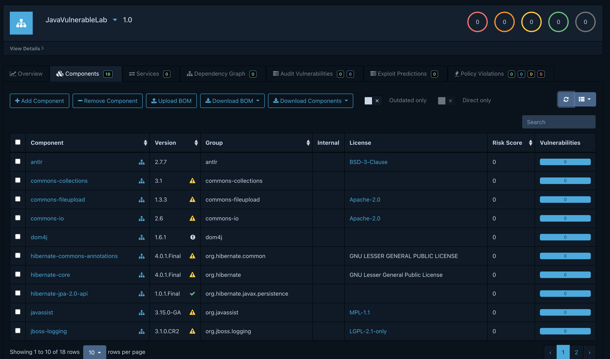

# Parte C - SBOM y Dependency-Track

## Generación del SBOM

Se generó un inventario de componentes del proyecto `JavaVulnerableLab` en formato CycloneDX JSON con el CycloneDX Maven Plugin. Se ejecutó desde la raíz del proyecto en macOS:

```zsh
mvn -B org.cyclonedx:cyclonedx-maven-plugin:2.9.1:makeAggregateBom \
  -DoutputFormat=json
```

El plugin produjo CycloneDX 1.6 en `target/bom.json`. El SBOM para esta entrega es [bom.json](./bom.json).

## Componentes

El SBOM contiene **18 componentes** en el arreglo `components`, además del componente raíz que identifica a `JavaVulnerableLab` versión `0.0.1-SNAPSHOT`. El conteo corresponde a los componentes incluidos en el documento, no al componente raíz.

## Iniciar Dependency-Track localmente

Se incluye el archivo [docker-compose.yml](./docker-compose.yml) para iniciar Dependency-Track con Docker Desktop. Desde la raíz del repositorio, ejecutar:

```zsh
docker --version
docker compose version
docker compose -f 'entregables/parte C/docker-compose.yml' up -d
docker compose -f 'entregables/parte C/docker-compose.yml' ps
```

Cuando el contenedor esté iniciado, abrir [http://localhost:8080](http://localhost:8080). En el primer inicio, las credenciales predeterminadas documentadas son `admin` / `admin`; Dependency-Track solicitará cambiar la contraseña. Después de completar ese primer inicio de sesión, usar `admin` / `admin123` para iniciar sesión. El primer arranque también descarga y prepara datos de vulnerabilidades, por lo que puede tardar varios minutos. No detener el servicio durante esa inicialización.

Para apagarlo conservando los datos, ejecutar desde la raíz:

```zsh
docker compose -f 'entregables/parte C/docker-compose.yml' down
```

No añadir `--volumes` si se quiere conservar los datos entre ejecuciones.

## Importación en Dependency-Track

En Dependency-Track, crear el proyecto con estos datos:

- **Nombre:** `JavaVulnerableLab`
- **Versión:** `1.0`

Con Dependency-Track iniciado en `http://localhost:8080`, crear el proyecto y, en la acción de carga de BOM, seleccionar [bom.json](./bom.json) y enviarlo. Esperar a que termine el procesamiento y el análisis.

Después de procesar el SBOM, revisar estas secciones del proyecto y registrar los resultados observados o adjuntar capturas:

- **Overview:** resumen del proyecto, métricas de componentes y vulnerabilidades.
- **Components:** lista de componentes reconocidos y sus versiones.
- **Audit Vulnerabilities:** vulnerabilidades detectadas, severidades y estado de auditoría.
- **Dependency Graph:** relaciones directas y transitivas entre componentes.

Si Overview o Audit Vulnerabilities muestran cero vulnerabilidades, revisar en **Administration > Vulnerability Sources** que OSV esté habilitado y ejecutar **Reanalyze** para el proyecto. El resultado depende de las fuentes activas y de la versión de sus datos.

## Ejemplo de dependencia transitiva vulnerable

El SBOM muestra esta ruta:

```text
JavaVulnerableLab
└── hibernate-core:4.0.1.Final
    └── dom4j:1.6.1
```

`hibernate-core:4.0.1.Final` está declarado en el `pom.xml` del proyecto. `dom4j:1.6.1` aparece debajo de Hibernate en las relaciones `dependencies` del SBOM y el reporte de Dependency-Check lo identifica como incluido por Hibernate, por lo que su origen es transitivo. El reporte local asocia `dom4j:1.6.1` con **CVE-2020-10683**, severidad **CRITICAL**, CVSS 3.1 **9.8**; la descripción del hallazgo indica que versiones anteriores a 2.0.3 y 2.1.x anteriores a 2.1.3 permiten DTD/entidades externas por defecto, con posible riesgo XXE.

En la captura del Dependency Graph se observa que `JavaVulnerableLab 1.0` depende de `hibernate-core:4.0.1.Final`, y que Hibernate incluye `dom4j:1.6.1`. Por tanto, `dom4j` es transitiva: el proyecto la recibe a través de Hibernate, aunque no la declare directamente. El mismo grafo muestra además que `dom4j` depende de `xml-apis:1.0.b2`.

La captura de Dependency-Track muestra **0 vulnerabilidades** en los contadores de Overview/Audit Vulnerabilities, por lo que esa imagen confirma la relación entre componentes, pero no demuestra que Dependency-Track haya detectado el CVE. La asociación de `dom4j:1.6.1` con **CVE-2020-10683** (CRITICAL, CVSS 3.1 9.8) proviene del reporte local de Dependency-Check. Para comprobar si Dependency-Track también lo detecta, verificar que OSV esté habilitado en **Administration > Vulnerability Sources** y ejecutar **Reanalyze**; después, actualizar la evidencia si aparece el hallazgo.

## Evidencia

Capturas tomadas en el proyecto `JavaVulnerableLab`, versión `1.0`:

- [Vista Components](./components.png)
- [Vista Dependency Graph](./dependency%20graph.png)

### Components



### Dependency Graph


La vista Components indica 18 componentes. Las capturas actuales muestran cero vulnerabilidades; si se habilita OSV y se ejecuta Reanalyze, actualizar esta evidencia con el resultado que presente la instancia.