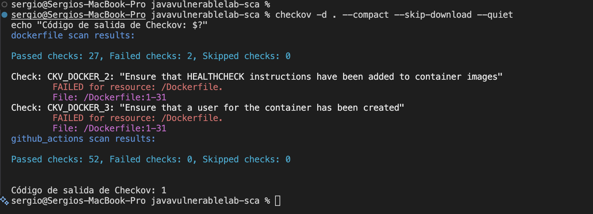
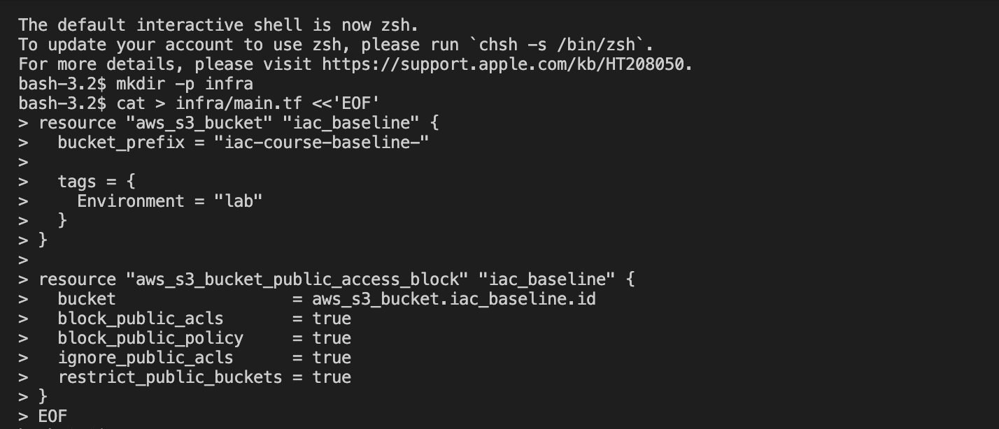
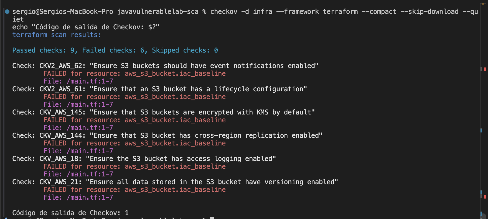
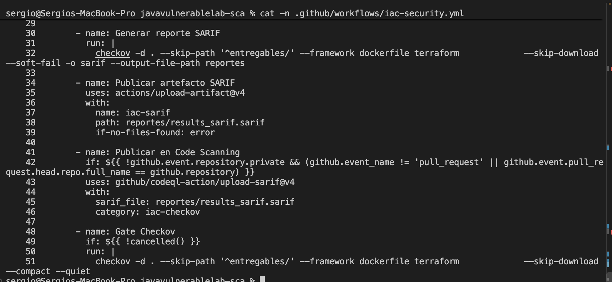
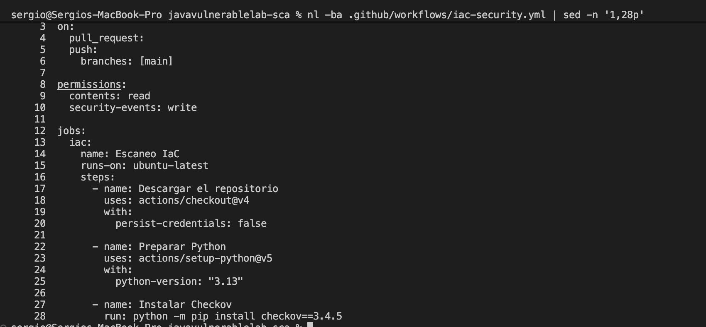
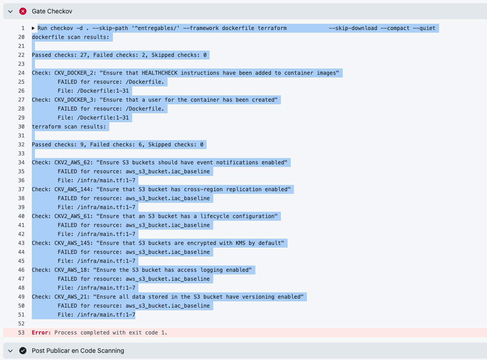
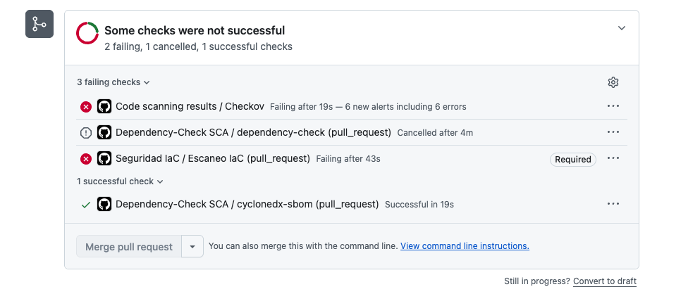
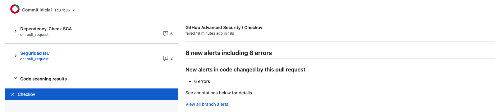

# Análisis de seguridad IaC en el pipeline

## 1. Portada

- Integrantes y matrículas: pendiente.
- Repositorio: https://github.com/solivalle/javavulnerablelab-sca
- Uso de IA: se utilizó Codex para leer la consigna, organizar la práctica y preparar los comandos. Completar esta nota con los usos posteriores.

## 2. Línea base local

### Paso 1. Ejecutar el escaneo local

Desde la raíz del repositorio:

```bash
checkov -d . --compact --skip-download --quiet
echo "Código de salida de Checkov: $?"
```

`--skip-download` omite la descarga de metadatos de Prisma Cloud tras una advertencia de certificado TLS. `--quiet` conserva los resúmenes y el detalle de los controles fallidos.



*Figura 1. Línea base local. El Dockerfile registró dos fallas (`CKV_DOCKER_2` y `CKV_DOCKER_3`) y el workflow de GitHub Actions aprobó sus 52 controles. Checkov devolvió el código de salida `1`.*

La consigna pide ejecutar `ansible-lint --profile production` si hay archivos de Ansible. En la rama actual no hay playbooks de Ansible, así que esa parte queda como **no aplica** para esta ejecución.

Esta primera corrida documenta el estado inicial del repositorio. La segunda ejecución amplió la línea base con Terraform antes de la remediación.

| Tipo de archivo | Controles aprobados | Fallas | Excepciones |
| --- | ---: | ---: | ---: |
| Dockerfile | 27 | 2 | 0 |
| GitHub Actions | 52 | 0 | 0 |
| Terraform | 9 | 6 | 0 |

| ID | Archivo o recurso | Riesgo real |
| --- | --- | --- |
| CKV_DOCKER_2 | Dockerfile | Sin `HEALTHCHECK`, Docker no dispone de esta comprobación para detectar si la aplicación deja de responder mientras el proceso sigue activo. |
| CKV_DOCKER_3 | Dockerfile | Sin un usuario no privilegiado declarado, el contenedor puede heredar un usuario con privilegios de la imagen base y aumentar el impacto de un fallo en la aplicación. |
| CKV_AWS_145 | `aws_s3_bucket.iac_baseline` | El código no exige cifrado predeterminado con AWS KMS, lo que limita el control sobre la clave y su uso. |
| CKV_AWS_144 | `aws_s3_bucket.iac_baseline` | Sin replicación entre regiones, una interrupción regional puede afectar la disponibilidad de la copia de datos. |
| CKV_AWS_18 | `aws_s3_bucket.iac_baseline` | Sin registros de acceso del bucket, se reduce la trazabilidad disponible para investigar solicitudes. |
| CKV_AWS_21 | `aws_s3_bucket.iac_baseline` | Sin versionado, recuperar una versión anterior tras un borrado o una sobrescritura accidental es más difícil. |
| CKV2_AWS_61 | `aws_s3_bucket.iac_baseline` | Sin reglas de ciclo de vida, los objetos pueden quedar almacenados más tiempo del previsto. |
| CKV2_AWS_62 | `aws_s3_bucket.iac_baseline` | Sin notificaciones de eventos, los procesos que dependen de ellas pueden tardar en detectar cambios. |

Los cinco hallazgos priorizados para el informe son `CKV_DOCKER_3`, `CKV_AWS_145`, `CKV_AWS_144`, `CKV_AWS_18` y `CKV_AWS_21`. La priorización considera privilegios del contenedor, control de claves, disponibilidad, trazabilidad y recuperación.

### Paso 2. Ampliar la línea base con Terraform

Ejecución verificada con Checkov y documentada en las figuras 2 y 3. El Terraform de la rama de referencia solo contiene un recurso local `terraform_data`. Para obtener resultados comparables de controles de almacenamiento, se agrega un bucket de ejemplo con bloqueo explícito del acceso público. El ejercicio analiza los archivos de forma estática y no ejecuta Terraform ni crea recursos en AWS.

Desde la raíz del repositorio:

```bash
mkdir -p infra
cat > infra/main.tf <<'EOF'
resource "aws_s3_bucket" "iac_baseline" {
  bucket_prefix = "iac-course-baseline-"

  tags = {
    Environment = "lab"
  }
}

resource "aws_s3_bucket_public_access_block" "iac_baseline" {
  bucket                  = aws_s3_bucket.iac_baseline.id
  block_public_acls       = true
  block_public_policy     = true
  ignore_public_acls      = true
  restrict_public_buckets = true
}
EOF

checkov -d infra --framework terraform --compact --skip-download --quiet
echo "Código de salida de Checkov: $?"
```



*Figura 2. La captura documenta la creación de `infra/main.tf` y el bloqueo del acceso público.*



*Figura 3. Checkov evaluó Terraform y registró 9 controles aprobados, 6 fallidos y 0 omitidos. Los seis hallazgos corresponden al recurso `aws_s3_bucket.iac_baseline` y la ejecución terminó con código de salida `1`.*

## 3. Diseño del pipeline

### Paso 3. Crear el workflow de GitHub Actions

Se creó `.github/workflows/iac-security.yml`. Para mostrarlo en la terminal desde la raíz del repositorio:

```bash
cat -n .github/workflows/iac-security.yml
```

El workflow se ejecuta en cada PR y en cada push a `main`. Escanea Terraform y Dockerfile en el repositorio y excluye las copias de evidencia de `entregables/`. Usa Checkov `3.4.5`, la versión de la línea base, para reducir diferencias entre corridas. El primer escaneo usa `--soft-fail` para publicar el SARIF incluso cuando hay hallazgos. El artefacto queda disponible en Actions y el workflow también envía el SARIF a Code Scanning en repositorios públicos para ejecuciones de la misma rama remota o PR del mismo repositorio. El gate vuelve a escanear y usa el código de salida original. Ansible queda fuera del workflow porque este repositorio no contiene playbooks.



*Figura 4. La captura muestra la generación del SARIF, su publicación como artefacto y en Code Scanning, y el gate que ejecuta Checkov sin `--soft-fail`.*



*Figura 5. El workflow se activa en cada `pull_request` y en los `push` a `main`. El job `Escaneo IaC` prepara Python 3.13 e instala Checkov 3.4.5.*

El log del PR confirma que GitHub Actions ejecutó el workflow y llegó al paso `Gate Checkov`. Los conteos coincidieron con la línea base local.

## 4. Evidencia del gate

En GitHub Actions, `Gate Checkov` reprodujo la línea base local. Fallaron 2 controles del Dockerfile y 6 de Terraform, con 0 omisiones en ambos bloques. El proceso devolvió el código de salida `1`.



*Figura 6. El log muestra los ocho controles fallidos y el código de salida 1.*

Después de activar el ruleset para `main`, GitHub marcó el check `Seguridad IaC / Escaneo IaC (pull_request)` como obligatorio. El check fallido dejó deshabilitado el botón de merge.



*Figura 7. GitHub muestra la etiqueta Required junto al check fallido y el botón Merge pull request deshabilitado.*

PR de prueba: [#2](https://github.com/solivalle/javavulnerablelab-sca/pull/2). Cerrado sin fusionar, según la confirmación del autor.

## 5. Evidencia SARIF

GitHub Code Scanning procesó el SARIF de Checkov para el commit `1d37b86` del PR #2. La vista del PR muestra seis alertas nuevas clasificadas como errores en el código modificado. El conteo de esta vista corresponde a las alertas nuevas del PR. El gate reportó ocho fallas en el conjunto de archivos escaneados.



*Figura 8. GitHub muestra seis alertas nuevas en el check de Code Scanning de Checkov.*

## 6. Remediación

Pendiente. Corregir al menos ocho hallazgos en un PR separado, con un commit por tipo de corrección. Registrar ID, recurso, cambio y resultados antes y después. Conservar el enlace al PR fusionado y la captura del check aprobado. La consigna pide aportes de ambos integrantes.

## 7. Excepción

Pendiente. Documentar exactamente una excepción en el código y en el informe. Registrar el control, la justificación, la referencia de aprobación, el rol de quien debe aprobarla y la fecha de vencimiento.

## 8. Política propia

Pendiente. Escribir una regla de Checkov en YAML en `politicas/`, integrarla con `--external-checks-dir politicas` y capturar un caso que falla y otro que pasa.

## 9. Conclusiones

Pendiente. Explicar qué quedó fuera de la cobertura del análisis estático y cómo se comprobaría.

Al finalizar, incorporar las capturas con rutas relativas, exportar el informe a `docs/informe.pdf`, comprobar que las imágenes se lean y preparar el enlace al repositorio para la entrega.
